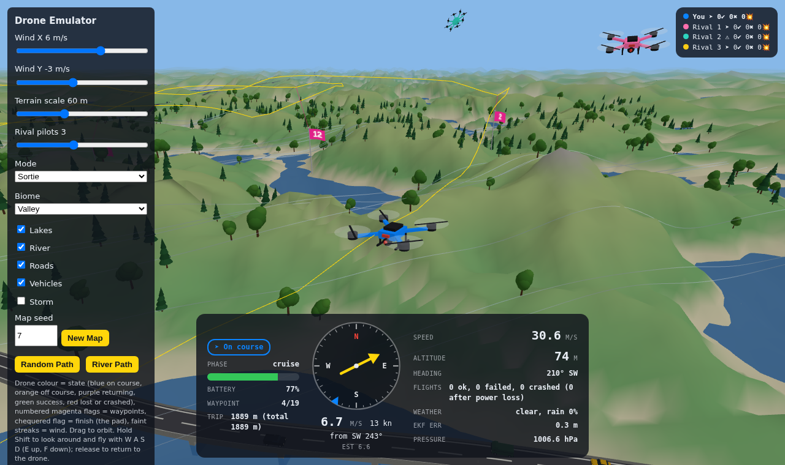
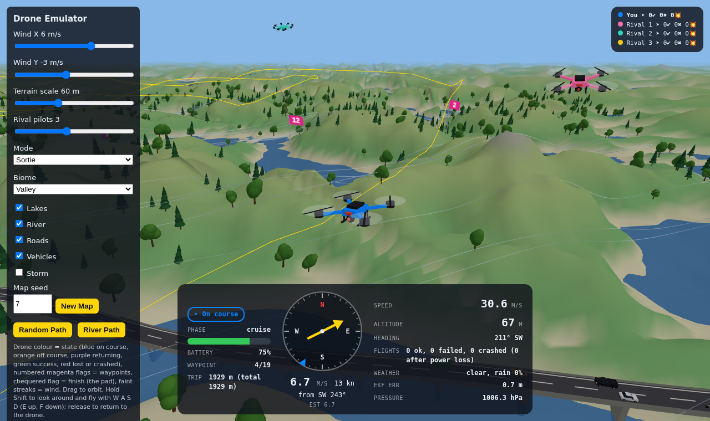
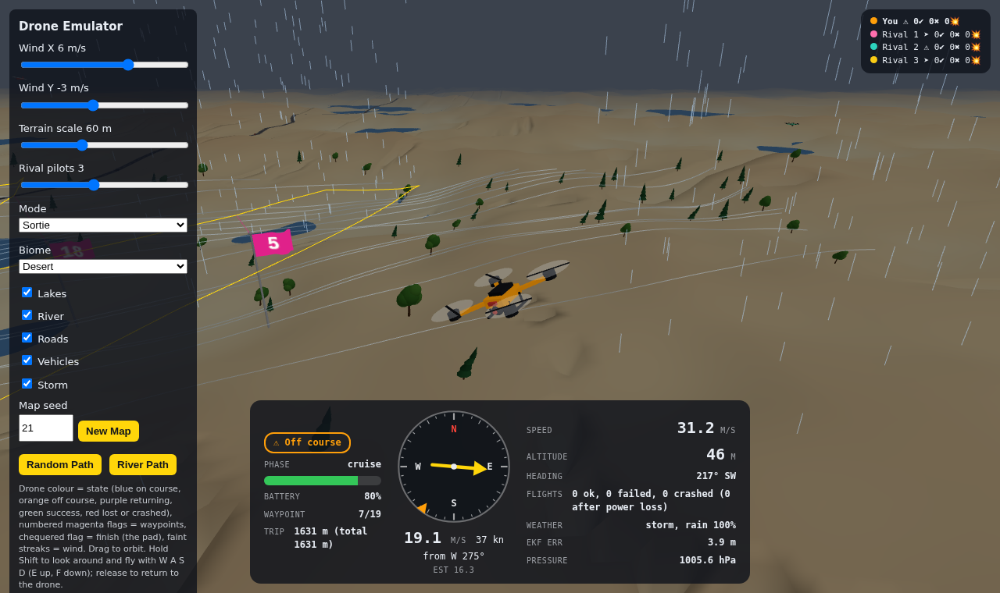
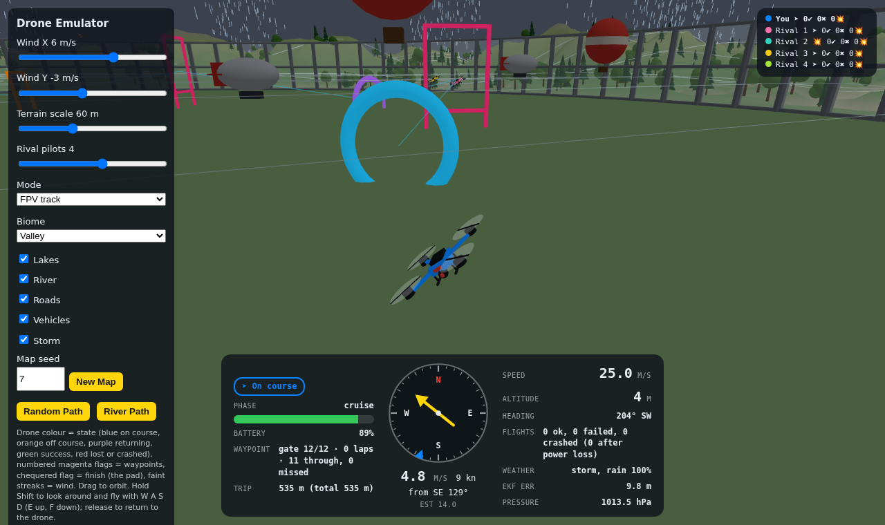
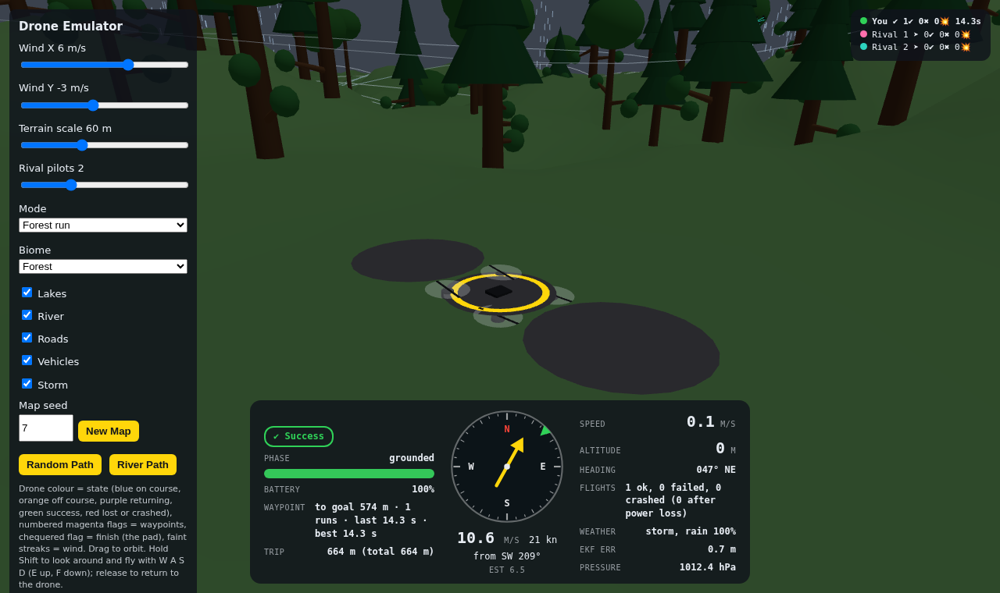

# Drone Emulator

Browser-only drone simulation: a small EKF-5 estimator (position, wind bias, pressure)
tracks a drone flying a random waypoint list over procedural simplex-noise terrain
(optional river), with drifting clouds, rain and lightning.

State is immutable: every step takes a `Snapshot` and returns a new one.

## Status

This was a fun side project, built while other builds were working their way through
CI/CD. It has reached a stop point: it is complete enough to play with, and no further
work is planned.

## Built with Claude

Written almost entirely by [Claude](https://www.anthropic.com/claude) (Anthropic's AI
assistant) using [Claude Code](https://claude.com/claude-code), directed by Miles Burton.

## Screenshots

| Sortie, valley                                              | Sortie, storm                                           |
| ----------------------------------------------------------- | ------------------------------------------------------- |
|  |  |

| Desert biome                                       | FPV track                                    | Forest run                                     |
| -------------------------------------------------- | -------------------------------------------- | ---------------------------------------------- |
|  |  |  |

The yellow line is the path the autopilot will actually fly; pink tethers tie each flag to it.

## Commands

| Command                | Purpose                                          |
| ---------------------- | ------------------------------------------------ |
| `npm run dev`          | Vite dev server                                  |
| `npm run build`        | Typecheck, then build a single `dist/index.html` |
| `npm test`             | Vitest                                           |
| `npm run lint`         | ESLint                                           |
| `npm run format:check` | Prettier                                         |

`dist/index.html` is self-contained and opens straight from the file system.

## Deployment

CI (`.github/workflows/ci.yml`) runs format, lint, typecheck, tests and build, then
deploys `dist/` to GitHub Pages on pushes to `main`. For a private repo, Pages must be
enabled (Settings → Pages → Source: GitHub Actions) and needs a plan that supports
private-repo Pages.
